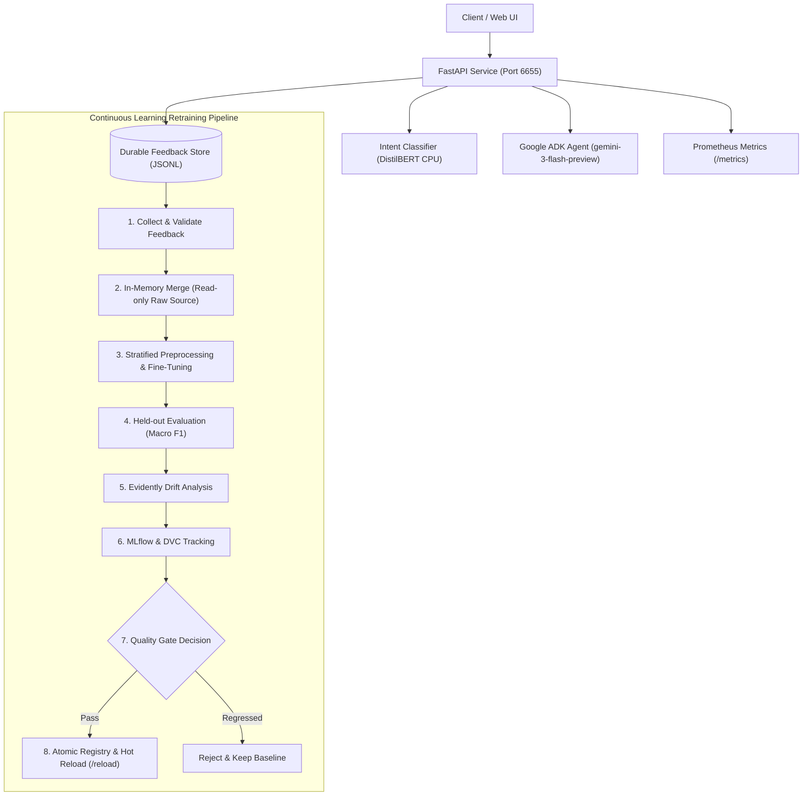

# AI ChatBot: Continuous Learning Pipeline & Google ADK Deployment

A production-grade, observable AI ChatBot service powered by Google Agent Development Kit (Google ADK / Gemini) and a fine-tuned DistilBERT intent classification pipeline. Features zero-downtime hot reloading, automated data drift monitoring with Evidently, Prometheus metrics, quality-gated continuous retraining, and atomic rollbacks.

---

## 1. System Architecture



---

## 2. API Endpoints Specification

| Route | Method | Description |
|---|---|---|
| `/health` | `GET` | Process liveness check (`200 OK`) |
| `/ready` | `GET` | Artifact readiness check — validates model checkpoint & prompt availability |
| `/chat` | `POST` | Primary conversation endpoint: classifies intent via BERT, invokes ADK runner |
| `/feedback` | `POST` | Collects user feedback & supervisor corrections (`201 Created`). Idempotent. |
| `/feedback/stats` | `GET` | Aggregate feedback statistics (counts, positive/negative ratio, eligible count) |
| `/metadata/model` | `GET` | Active model version, num_classes, and artifact path |
| `/metadata/prompt`| `GET` | Active system prompt version, file path, and token length |
| `/metrics` | `GET` | Prometheus-compatible metrics endpoint (supports optional Bearer token auth) |
| `/reload` | `POST` | Zero-downtime hot reload: refreshes active model & instruction pointers |

---

## 3. Environment Variables & Runtime Secrets

Configure these environment variables in your deployment platform (e.g., Secret Manager, `.env`, or Docker runtime):

| Variable | Required | Default | Description |
|---|---|---|---|
| `GEMINI_API_KEY` | Production | None | Google Gemini API Key powering Google ADK reasoning |
| `ADK_OFFLINE_MODE` | Testing | `false` | When `true`, simulates ADK responses for offline test suites |
| `PORT` | Optional | `6655` | Service listening port |
| `METRICS_AUTH_TOKEN`| Optional | None | Bearer token to protect `/metrics` endpoint |
| `ALLOWED_ORIGINS` | Optional | `*` | Comma-separated CORS allowed origins |
| `FEEDBACK_STORAGE_PATH` | Optional | `ChatBot-PipeLine/data/feedback/user_feedback.jsonl` | Mount point for persistent feedback volume |
| `DO_NOT_TRACK` | Optional | `1` | Opt-out of Evidently/telemetry tracking |
| `EVIDENTLY_DISABLE_TELEMETRY` | Optional | `1` | Disables telemetry timeouts during drift evaluation |
| `MLFLOW_ALLOW_FILE_STORE` | Optional | `true` | Allows local file-based MLflow tracking store |

> [!CAUTION]
> Never commit API keys or credentials to version control. Pass them exclusively via runtime environment variables or your cloud provider's Secret Manager.

---

## 4. Local Deployment & Verification

### A. Run Locally
```bash
# 1. Install pinned requirements
pip install -r requirements.txt

# 2. Start API service
python -m uvicorn ADKBot.api:app --host 0.0.0.0 --port 6655
```

### B. Execute Comprehensive Local Smoke Tests
A self-contained smoke test verifying all 8 endpoints, intent classification, feedback persistence, and hot reloading is provided in `test_deployment_local.py`:
```bash
python test_deployment_local.py
```

### C. Sample Queries
```bash
# Liveness check
curl -s http://localhost:6655/health

# Readiness check
curl -s http://localhost:6655/ready

# Chat query
curl -s -X POST http://localhost:6655/chat \
  -H "Content-Type: application/json" \
  -d '{"message": "Good morning, assistant!"}'

# Submit feedback with ground-truth correction
curl -s -X POST http://localhost:6655/feedback \
  -H "Content-Type: application/json" \
  -d '{
    "request_id": "<request_id_from_chat>",
    "rating": "positive",
    "corrected_intent": "Greeting",
    "textual_feedback": "Verified morning greeting"
  }'

# Scrape Prometheus metrics
curl -s http://localhost:6655/metrics
```

---

## 5. Docker & Containerized Deployment

### Standalone Docker Run
```bash
# Build production image
docker build -t aichatbot-api:latest .

# Run with non-root user and persistent feedback storage
docker run -d --name chatbot-api -p 6655:6655 \
  -e GEMINI_API_KEY="your-gemini-api-key" \
  -v chatbot_feedback:/app/ChatBot-PipeLine/data/feedback \
  aichatbot-api:latest
```

### Docker Compose with Prometheus
```bash
# Launches both ChatBot API (6655) and Prometheus monitoring (9090)
docker-compose up -d
```

---

## 6. Remote Cloud Deployment Guide

Deployment configurations are included for major cloud targets:

### Option 1: Google Cloud Run (Recommended for Google ADK)
Use `cloudrun.yaml` for managed serverless deployment with native Google ADK scaling:
```bash
gcloud run services replace cloudrun.yaml --region us-central1
```

### Option 2: Render (with Persistent Disk)
Use `render.yaml` for 1-click deployment with persistent feedback storage:
1. Connect this repository in the Render Dashboard.
2. Render creates the Web Service and mounts a persistent disk (`/var/data/feedback`).
3. Set `GEMINI_API_KEY` securely in the Render Environment tab.

### Option 3: Fly.io (with Volume)
Use `fly.toml` for global Edge deployment:
```bash
flyctl volumes create chatbot_feedback_data --size 1
flyctl deploy
```

---

## 7. Continuous Retraining & Rollback Procedures

### Retraining Pipeline (14 Stages)
Retraining validates approved feedback, trains a fine-tuned candidate initialized from baseline weights, evaluates against the held-out test split, runs Evidently drift analysis, and logs to MLflow/DVC:

```bash
# Dry-run evaluation (no deployment)
python ChatBot-PipeLine/src/pipeline/retraining_pipeline.py --dry-run --min-feedback 0

# Trigger retraining and candidate promotion
python ChatBot-PipeLine/src/pipeline/retraining_pipeline.py --force-promote --min-feedback 0
```

### Rollback to Known-Good Baseline
If an issue arises with an active candidate, atomically roll back immediately:
```bash
python ChatBot-PipeLine/src/pipeline/retraining_pipeline.py --rollback v0.1.0-baseline
```

---

## 8. Deployment Status & Verification Checklist

| Requirement | Local Environment | Remote Cloud Environment |
|---|---|---|
| **ADK Agent / FastAPI Service** | Verified (HTTP 200/201 on all endpoints) | Ready for deployment |
| **Model & Instruction Resolution** | Verified (`v0.1.0-baseline` / `v1.0.0`) | Bundled in Docker image / config |
| **Durable Feedback Persistence** | Verified (re-indexes `user_feedback.jsonl`) | Volume mounted (`render.yaml`, `fly.toml`) |
| **Prometheus Observability** | Verified (`/metrics` text exposition) | Scraped by `prometheus.yml` |
| **CORS Allowed Origins** | Verified (configurable via `ALLOWED_ORIGINS`)| Configured in deployment YAMLs |
| **Candidate Retraining & Gate** | Verified (Stages 1–13 completed in 53s) | Automated via `.github/workflows/retrain.yml`|
| **Atomic Rollback** | Verified (`rollback v0.1.0-baseline`) | Supported via pipeline CLI |
| **Cloud Authentication & Secrets** | Not configured locally (offline mode verified)| Blocked (requires user cloud credentials) |

### Remote Deployment Next Steps (Blocker Resolution)
To complete public remote deployment:
1. Provide a `GEMINI_API_KEY` secret in your target platform (Google Cloud, Render, or Fly.io).
2. For Cloud Run: authenticate using `gcloud auth login` and run `gcloud run services replace cloudrun.yaml`.
3. For Render: connect repository and set `RENDER_DEPLOY_HOOK_URL` in GitHub Secrets.

