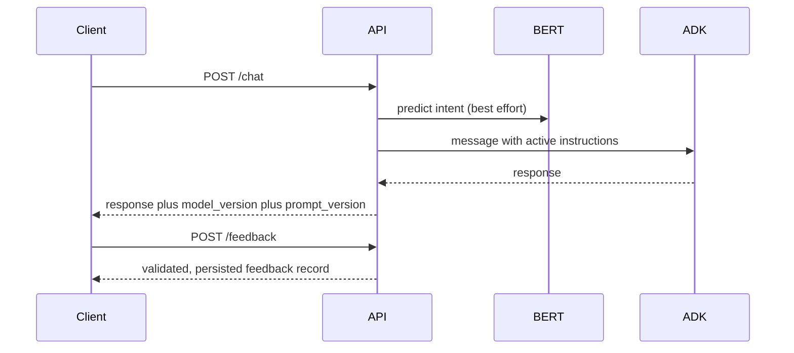

# AI ChatBot with Continuous-Learning MLOps

FastAPI exposes a Google ADK/Gemini conversational agent alongside a local DistilBERT intent classifier. The classifier provides intent metadata only: every chat request is still sent to the ADK agent, including low-confidence or unavailable intent predictions. Gemini is a foundation model used by ADK; it is not fine-tuned by this repository.

## Architecture and responsibilities

```mermaid
flowchart LR
  U[Client] --> A[FastAPI /chat]
  A --> B[DistilBERT intent metadata]
  A --> C[Google ADK agent / Gemini]
  A --> D[Version pair in response]
  A --> F[JSONL feedback store]
  A --> P[/metrics Prometheus]
  F --> R[Retraining pipeline]
  R --> S[Read-only raw Intent.json plus validated feedback]
  S --> T[Train candidate and held-out evaluation]
  T --> E[Evidently report]
  T --> M[MLflow artifacts and metrics]
  T --> G{Quality gate}
  G -- pass --> V[Atomic model/prompt pointers and reload]
  G -- fail --> K[Reject; prior version remains active]
```

| Component | Responsibility |
|---|---|
| `ChatBot/ADKBot/api.py` | Chat, feedback, metadata, readiness, reload, and Prometheus endpoints. |
| `ChatBot/ADKBot/agent.py` | Loads versioned ADK instructions and creates the Google ADK agent. |
| `ChatBot-PipeLine/src/model/` | Preprocessing, training, inference, checkpoint, tokenizer, and label mapping. |
| `common/feedback_store.py` | Append-only JSONL feedback persistence, schema validation, and idempotency. |
| `src/pipeline/retraining_pipeline.py` | Candidate creation, evaluation, reporting, quality gate, promotion, rollback. |
| `common/config_resolver.py` | Deterministic active model/prompt resolution. |



## Setup and reproducible verification

Python 3.11 is the CI target. Keep `GEMINI_API_KEY` out of source control.

```bash
python -m pip install --upgrade pip
python -m pip install torch --index-url https://download.pytorch.org/whl/cpu
python -m pip install -r requirements.txt
set ADK_OFFLINE_MODE=true
python -m uvicorn ADKBot.api:app --app-dir ChatBot --host 0.0.0.0 --port 6655
```

Set `ADK_OFFLINE_MODE=false` and supply `GEMINI_API_KEY` to test the real ADK provider. Offline mode validates the integration path but does not verify a remote Gemini response.

In a second terminal:

```bash
set ADK_OFFLINE_MODE=true
set DO_NOT_TRACK=1
set EVIDENTLY_DISABLE_TELEMETRY=1
set MLFLOW_ALLOW_FILE_STORE=true
python -m pytest ChatBot-PipeLine/tests -v -p no:faker
python test_deployment_local.py
dvc repro
python ChatBot-PipeLine/src/evaluation/evaluate.py --model-dir artifacts/models/v0.1.0-baseline --test-data ChatBot-PipeLine/data/processed/test.json --output-metrics artifacts/metrics/v0.1.0-baseline_test_metrics.json
python ChatBot-PipeLine/src/pipeline/retraining_pipeline.py --dry-run --min-feedback 3
```

The DVC commands require the tracked `ChatBot-PipeLine/data/raw/Intent.json` and a working DVC installation. Training saves model weights, tokenizer, and `label_mapping.json`; evaluation writes JSON metrics; MLflow writes local runs under `ChatBot-PipeLine/mlruns` when no remote URI is configured. DagsHub sync is optional and requires a deliberately configured MLflow/DagsHub URI and credentials; it is not implied by a local run.

```bash
curl http://127.0.0.1:6655/health
curl http://127.0.0.1:6655/ready
curl -X POST http://127.0.0.1:6655/chat -H "Content-Type: application/json" -d "{\"message\":\"Hello\"}"
curl http://127.0.0.1:6655/metadata/model
curl http://127.0.0.1:6655/metadata/prompt
curl http://127.0.0.1:6655/metrics
```

## Feedback, retraining, and rollback

`POST /feedback` accepts positive and negative ratings, but only a record with a valid `corrected_intent` is training-eligible. Duplicate `request_id` values return HTTP 409. Unknown labels return HTTP 400 when the active label mapping is available. Feedback is append-only JSONL; mount its directory as persistent storage in production.

The pipeline skips an ordinary run below `--min-feedback`. A manually requested run (`--force-promote`) can bypass only that scheduling threshold; it cannot bypass artifact validation, minimum accuracy, minimum macro-F1, or the non-regression check. A candidate that cannot activate is rolled back to the previous model/prompt pointers.

```bash
python ChatBot-PipeLine/src/pipeline/retraining_pipeline.py --rollback v0.1.0-baseline
```

## Container and deployment

```bash
docker build -t aichatbot-api:latest .
docker run --rm -p 6655:6655 -e ADK_OFFLINE_MODE=true aichatbot-api:latest
docker compose up --build
```

`cloudrun.yaml`, `render.yaml`, and `fly.toml` are deployment templates. GitHub workflows run unit/contract tests, build a Docker image, and expose a manual deployment workflow. A remote deployment is verified only after its platform credentials, secrets, health endpoint, and smoke test have actually been run.

## Render deployment guide

This repository currently contains no `package.json`, Vite configuration, or React source tree. It therefore deploys **one backend Web Service**, not a Render Static Site. If a frontend is later added, deploy it separately as a Static Site, set its build-time API variable (for example `VITE_API_BASE_URL`) to the backend HTTPS origin, and use that exact Static Site origin in the backend `ALLOWED_ORIGINS`; do not hard-code `localhost` in browser code.

Create the Web Service from the repository root (`.`) using the checked-in [render.yaml](render.yaml). Its settings are:

| Render setting | Value |
|---|---|
| Environment | Docker |
| Dockerfile path / context | `./Dockerfile` / repository root |
| Start command | Image entrypoint `/app/scripts/render-start.sh` |
| Bind address / port | `0.0.0.0` / Render-provided `PORT` |
| Health check | `GET /health` |
| Persistent disk | `chatbot-state` mounted at `/var/data`, at least 1 GB |

Set these Render environment variables as secrets: `GEMINI_API_KEY`, `METRICS_AUTH_TOKEN`, `ALLOWED_ORIGINS`, `DAGSHUB_USERNAME`, and `DAGSHUB_TOKEN`. The first start uses DVC to obtain `artifacts/models/v0.1.0-baseline` if it is not bundled in the build, then copies it to `/var/data/models`. Feedback is stored at `/var/data/feedback/user_feedback.jsonl`. Do not enable `ADK_OFFLINE_MODE` in production. `MODEL_ARTIFACTS_DIR=/var/data/models` and `FEEDBACK_STORAGE_PATH=/var/data/feedback/user_feedback.jsonl` are supplied by the blueprint.

The disk is required because Render Web Service filesystem changes outside it are ephemeral. The baseline DVC artifact must be available to the configured DVC remote; otherwise first boot intentionally fails instead of serving without the intended classifier. A Render persistent disk is a paid-service consideration. DagsHub storage and a Gemini API account may also incur charges under their respective plans.

For retraining CI, configure GitHub repository secrets `DAGSHUB_USERNAME`, `DAGSHUB_TOKEN`, `MLFLOW_TRACKING_URI`, `MLFLOW_TRACKING_USERNAME`, and `MLFLOW_TRACKING_PASSWORD`. `GEMINI_API_KEY` is only needed for a provider-backed agent check; candidate training runs in offline ADK mode. The scheduled/manual workflow pulls tracked DVC inputs, trains and evaluates a candidate, sends experiment data to the configured MLflow URI, and publishes DVC data only when `DVC_PUSH_ON_RETRAIN=true`. It runs in dry-run mode and never changes the serving version or deploys Render automatically. Promote only through a reviewed change after the candidate meets the gate, then deploy that reviewed version.

After a manual Render deploy, verify `GET /health`, `GET /ready`, `GET /metadata/model`, and `GET /metadata/prompt`; submit an offline-safe feedback test; and scrape `/metrics` with the configured Bearer token. Finally run a real chat only after the Gemini credential is configured. No Render service URL is known or claimed by this repository.

## Current audit status (2026-10-29)

The configured active pair is `v0.1.0-baseline` / `v1.0.0`. The saved baseline evaluation artifact reports accuracy `0.6818` and macro-F1 `0.6061`. Candidate metadata contains accuracy `0.6364` and macro-F1 `0.5712`; both candidates are below the configured `0.85` accuracy and `0.80` macro-F1 gates, so they are rejected and are not active. These are saved artifacts, not values re-measured by this audit.

No public deployment URL, DagsHub sync, Docker run, or provider-backed ADK test is claimed without credentials and a working local runtime.

## College demonstration checklist

- [ ] Start offline API; show `/health`, `/ready`, and model/prompt metadata.
- [ ] Send a greeting, normal question, and low-confidence input; show ADK response and version pair.
- [ ] Submit positive, negative, corrected, invalid, and duplicate feedback; show status codes and `/feedback/stats`.
- [ ] Run preprocessing, training/evaluation or DVC reproduction; show checkpoint, tokenizer, label mapping, metrics, MLflow, and Evidently artifacts.
- [ ] Show insufficient-feedback skip, rejected candidate, passing-gate test, and rollback behavior.
- [ ] Show `/metrics`, Docker smoke test, and GitHub Actions workflow files.
