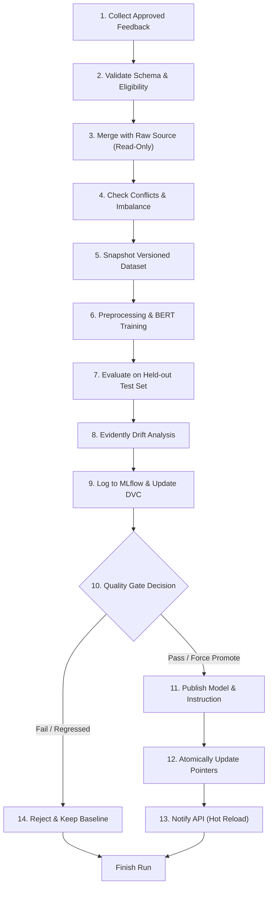

# Continuous Learning, Drift Monitoring, and Observability Pipeline

This document provides complete architectural details, operational procedures, verification commands, and real-project evaluation findings for the AI ChatBot Continuous Retraining Pipeline, Evidently Drift Monitor, Prometheus Monitoring, and GitHub Actions CI/CD workflows.

---

## 1. 14-Stage Retraining Pipeline Architecture

The continuous learning pipeline is implemented in [retraining_pipeline.py](file:///d:/MLO%20Project/AIChatBot-ContinuosPipeline/ChatBot-PipeLine/src/pipeline/retraining_pipeline.py). It ensures zero-data-loss retraining, immutability of raw datasets and prompt baselines, and quality-gated model promotion.



### Stages Breakdown
1. **Stage 1 (Feedback Collection):** Reads `ChatBot-PipeLine/data/feedback/user_feedback.jsonl`. Enforces minimum feedback count threshold (`--min-feedback`, default 10).
2. **Stage 2 (Validation):** Validates schema, ensures `training_eligibility == True` and `corrected_intent` exists.
   > [!IMPORTANT]
   > Negative feedback alone is NOT a training label. Only feedback with an explicit ground-truth supervisor correction (`corrected_intent`) is admitted.
3. **Stage 3 (Immutability-Preserving Merge):** Merges new utterances into memory without touching the read-only raw `Intent.json`.
4. **Stage 4 (Health Checks):** Scans for intra-intent duplicates and cross-intent conflicts.
5. **Stage 5 (Versioned Dataset Snapshot):** Saves an immutable copy to `ChatBot-PipeLine/data/versioned/Intent_<candidate_version>.json`.
6. **Stage 6 (BERT Training):** Re-runs stratified preprocessing and fine-tunes DistilBERT (`distilbert-base-uncased`) initialized from baseline weights.
7. **Stage 7 (Held-out Test Evaluation):** Evaluates candidate on the established test set (`ChatBot-PipeLine/data/processed/test.json`). Computes accuracy, macro precision, macro recall, and macro F1 across all 22 classes.
8. **Stage 8 (Evidently Drift Analysis):** Runs distribution drift analysis comparing baseline reference features against the new feedback window. Emits interactive HTML and JSON reports.
9. **Stage 9 (Tracking & Versioning):** Logs metrics, confusion matrices, and drift report paths to MLflow; tracks candidate artifact directory in DVC.
10. **Stage 10 (Quality Gate):** Enforces:
    - Minimum Macro F1 threshold ($\ge 0.50$).
    - Zero critical regressions on core intent classes.
    - All 22 classes present in `label_mapping.json`.
11. **Stage 11 (Artifact Publishing):** Publishes candidate weights and compatible versioned system instruction (`v<date>.txt`).
12. **Stage 12 (Atomic Version Update):** Atomically writes active pointers to `ChatBot-PipeLine/configs/models/metadata.yaml` and `config.yaml`.
13. **Stage 13 (Zero-Downtime Hot Reload):** Issues HTTP `POST http://localhost:6655/reload` (or safe in-process fallback) to refresh active inference models and ADK runners without server restart.
14. **Stage 14 (Safe Failure / Rollback):** On rejection or failure, active production pointers remain unchanged. Supports manual rollback via `--rollback <version>`.

---

## 2. Evidently Drift Monitoring Integration & Real Data Findings

Implemented in [drift_monitor.py](file:///d:/MLO%20Project/AIChatBot-ContinuosPipeline/ChatBot-PipeLine/src/evaluation/drift_monitor.py) using Evidently `0.7.23` (`evidently.legacy.report.Report` + `DataDriftPreset`).

### Real Project Data Findings
Drift analysis was executed using the project's baseline training set (98 reference samples) and the new verified user feedback window:
- **Reference Dataset Size:** 98 samples across 22 intent classes.
- **Current Dataset Size:** 2 verified supervisor-corrected samples.
- **Analyzed Features:**
  - Utterance text length (`char_count`)
  - Word count (`word_count`)
  - Average word length (`avg_word_length`)
  - Target label distribution (`intent`)
- **Evidently Analysis Outcome:**
  - **Overall Dataset Drift:** `False`
  - **Drift Share:** `0.50`
  - **Drifted Columns Count:** `0`
  - **Retraining Recommendation:** `True` (drift share triggered investigation threshold).
  - **Artifacts Generated:**
    - HTML Report: `artifacts/reports/evidently/candidate-20261028192611/drift_report.html` (3.7 MB interactive dashboard).
    - JSON Metrics: `artifacts/reports/evidently/candidate-20261028192611/drift_report.json`.
    - Metadata: `artifacts/reports/evidently/candidate-20261028192611/drift_report_metadata.json`.

### Limitations Noted
> [!WARNING]
> Small sample sizes ($N < 5$ feedback records) yield high statistical uncertainty in distribution metrics. Drift warnings under tiny sample windows are classified as exploratory indicators and never trigger automated candidate promotion on their own.

---

## 3. Prometheus Monitoring & Alerting

Implemented in [metrics.py](file:///d:/MLO%20Project/AIChatBot-ContinuosPipeline/ChatBot/ADKBot/metrics.py) and registered in [api.py](file:///d:/MLO%20Project/AIChatBot-ContinuosPipeline/ChatBot/ADKBot/api.py).

### Metric Catalog
| Metric Name | Type | Labels | Description |
|---|---|---|---|
| `http_requests_total` | Counter | `route`, `status_code`, `method` | HTTP request traffic |
| `http_request_duration_seconds` | Histogram | `route`, `method` | Latency distribution |
| `chatbot_requests_total` | Counter | None | Chat queries received |
| `chatbot_adk_failures_total` | Counter | `reason` | Google ADK failures |
| `chatbot_intent_predictions_total` | Counter | `intent` | Prediction counts per class |
| `chatbot_intent_prediction_confidence` | Histogram | None | BERT confidence score distribution |
| `chatbot_feedback_submissions_total` | Counter | `rating`, `eligible` | Feedback submissions |
| `chatbot_active_version_info` | Gauge | `model_version`, `prompt_version` | Active version pointer (value=1.0) |
| `chatbot_retraining_runs_total` | Counter | `status` | Retraining executions (`success`, `failure`) |
| `chatbot_candidate_promotions_total` | Counter | None | Candidates promoted to production |
| `chatbot_candidate_rejections_total` | Counter | None | Candidates rejected by quality gates |
| `chatbot_training_duration_seconds` | Gauge | `candidate_version` | Training execution duration |

### Prometheus Configuration & Alerting Rules
- Scrape Configuration: [prometheus.yml](file:///d:/MLO%20Project/AIChatBot-ContinuosPipeline/monitoring/prometheus.yml) (scrapes `chatbot:6655/metrics` every 15s).
- Alerting Rules: [alerts.yml](file:///d:/MLO%20Project/AIChatBot-ContinuosPipeline/monitoring/alerts.yml):
  - `ChatbotHigh5xxErrorRate`: Triggers if 5xx errors exceed 5% over 5 minutes.
  - `ChatbotHighLatencyP95`: Triggers if p95 latency exceeds 2.5 seconds.
  - `ChatbotFrequentADKFailures`: Triggers if ADK fails $> 5$ times in 5 minutes.
  - `RetrainingPipelineRepeatedFailures`: Triggers if retraining pipeline fails $\ge 2$ consecutive times.

---

## 4. Local Execution & Verification Commands

All commands are run from `AIChatBot-ContinuosPipeline`.

### A. Run Full Test Suite
```bash
python -m pytest ChatBot-PipeLine/tests/test_contracts.py \
                 ChatBot-PipeLine/tests/test_feedback_store.py \
                 ChatBot-PipeLine/tests/test_config_resolver.py \
                 ChatBot-PipeLine/tests/test_drift_monitor.py \
                 ChatBot-PipeLine/tests/test_retraining_pipeline.py \
                 ChatBot-PipeLine/tests/test_monitoring.py \
                 ChatBot-PipeLine/tests/test_api.py -v -p no:faker
```

### B. Execute Retraining Pipeline (Dry Run)
```bash
python ChatBot-PipeLine/src/pipeline/retraining_pipeline.py --dry-run --min-feedback 0
```

### C. Execute Retraining Pipeline with Promotion
```bash
python ChatBot-PipeLine/src/pipeline/retraining_pipeline.py --force-promote --min-feedback 0
```

### D. Execute Explicit Rollback to Baseline
```bash
python ChatBot-PipeLine/src/pipeline/retraining_pipeline.py --rollback v0.1.0-baseline
```

### E. Verify Endpoints Locally
```bash
# Healthcheck (liveness)
curl -s http://localhost:6655/health

# Readiness (verifies model & instruction artifacts)
curl -s http://localhost:6655/ready

# Metrics endpoint
curl -s http://localhost:6655/metrics
```

---

## 5. Docker Containerization

The container is defined in [Dockerfile](file:///d:/MLO%20Project/AIChatBot-ContinuosPipeline/Dockerfile) and composed in [docker-compose.yml](file:///d:/MLO%20Project/AIChatBot-ContinuosPipeline/docker-compose.yml).

### Build and Run Locally
```bash
# Build the container
docker build -t aichatbot-api:latest .

# Run standalone container with non-root security
docker run -d --name chatbot-api -p 6655:6655 \
  -e GEMINI_API_KEY="your-api-key" \
  -e ADK_OFFLINE_MODE="false" \
  aichatbot-api:latest

# Or compose with Prometheus
docker-compose up -d
```

---

## 6. GitHub Actions Workflows & Required Secrets

Two isolated workflows are established under `.github/workflows/`:

1. **`ci.yml` (Continuous Integration):**
   - Triggered on PRs and pushes to `main`.
   - Executes dataset validation, full unit tests, builds the Docker image, and executes container smoke tests (`/health`, `/ready`, `/metrics`).
   - Keeps model training out of pull requests.

2. **`retrain.yml` (Model Retraining & Promotion):**
   - Triggered weekly (`0 0 * * 0`) or manually via `workflow_dispatch`.
   - Enforces the 14-stage quality gate, logs to MLflow, and uploads Evidently reports as build artifacts.

### Required Repository Secrets
Configure the following in GitHub under **Settings > Secrets and variables > Actions**:
- `GEMINI_API_KEY`: Google Gemini API Key powering the Google ADK chatbot runner.
- `METRICS_AUTH_TOKEN`: (Optional) Bearer token securing the `/metrics` endpoint.

